# FM1 Bass Station RC3

- [Latest GitHub release](https://github.com/Kayman18/FM1-NovationBassStation/releases/latest)
- [RC3 firmware for normal updates](FM1-BassStation-RC3.fwsc)
- [USB-C Web MIDI editor](FM1-BassStation-RC3-Web-Editor.zip)
- [Browsable source](source/) and [source archive](FM1-BassStation-RC3-Project-Source.tar.xz)
- [Release notes](FM1-BassStation-RC3-Release-Notes.md) and [SHA-256 checksums](RC3-SHA256SUMS.txt)

Press **SEL** to open Presets. Turn **PRESET** or **SELECT** to load a patch immediately, or turn **ALGO** to switch banks. Outside Presets, **SELECT** controls Cutoff and **ALGO** controls Resonance. On SEQ, **PRESET** selects the Generate panel or the step being edited.

Each preset recalls with Cutoff at 50% (about 224 Hz). Turning **SELECT** or **ALGO** briefly shows both filter values below the page title. The Filter page displays its current values directly.

## FM-1 screens

These 240 × 240 captures come from the firmware simulator.

| Home | Presets |
| --- | --- |
| 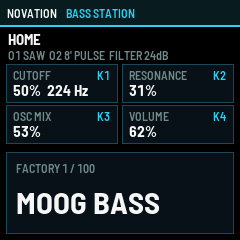 | 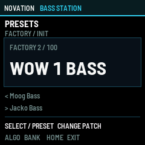 |

| LFO with filter overlay | Filter |
| --- | --- |
| 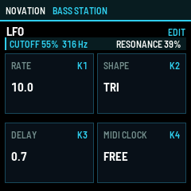 | 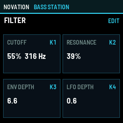 |

| Generate · Timing | Generate · Key & Gate | Generate · Slide & Clock |
| --- | --- | --- |
| 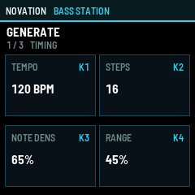 | 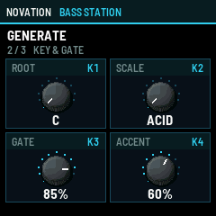 | 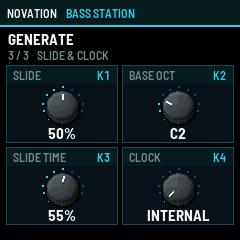 |

| Mutate | Piano Roll | Gate |
| --- | --- | --- |
| 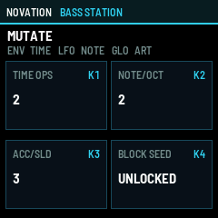 | 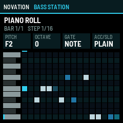 | 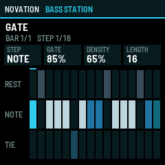 |

| Octave | Accent | Slide |
| --- | --- | --- |
| 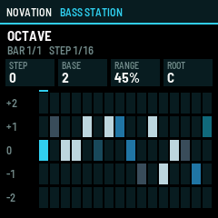 | 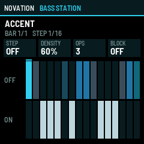 | 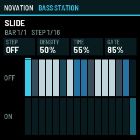 |

## Firmware updates

Use the FWSC file to update an existing FM-1 and preserve its USER bank. The [clean-install M-Flasher image](recovery/FM1-BassStation-RC3-CLEAN-INSTALL-M-Flasher.bin) writes the entire flash, including saved USER patches and settings. Use it for clean installation or recovery.

[Build instructions](source/README-FIRST.md) cover the target firmware and host simulator.
